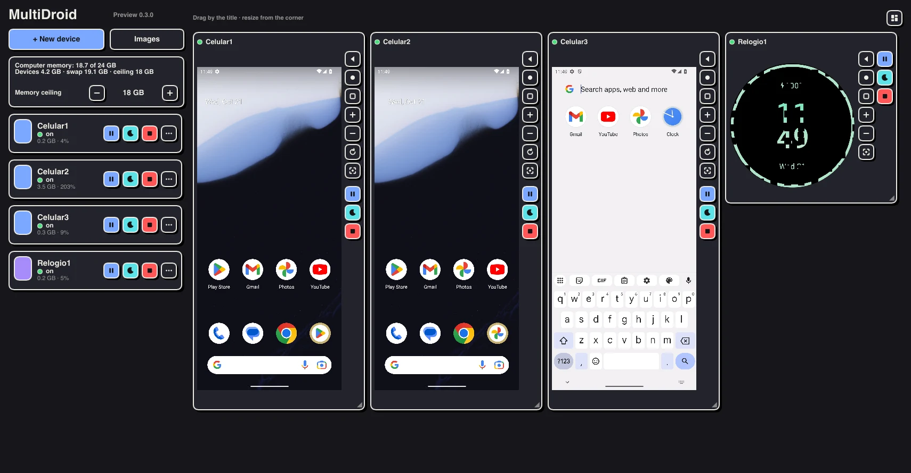
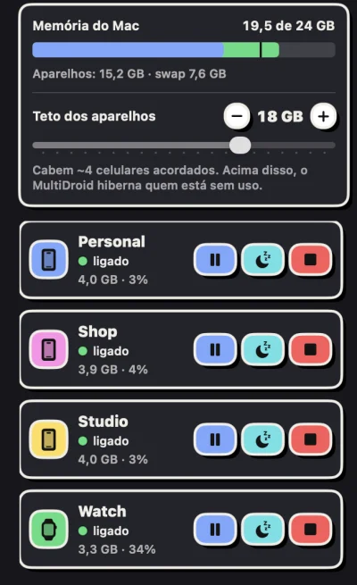
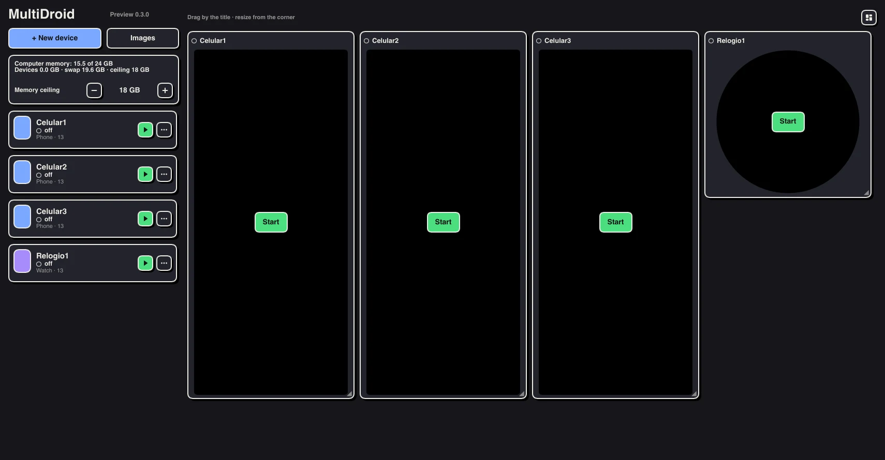

# MultiDroid

  [](LICENSE) 

Um ambiente para rodar várias contas e aparelhos Android ao mesmo tempo, no seu Mac.

Site: <https://multidroid.falcaosl.com> · Download: [MultiDroid 0.2 (.dmg assinado e notarizado)](https://github.com/iramarfalcao/MultiDroid/releases/latest)

## O que é

Um app nativo de Mac (SwiftUI, Swift Package) que controla vários Android Emulators oficiais sem janela e os organiza numa mesa que você arruma do seu jeito: celular, tablet, dobrável e relógio (Wear OS), cada um com as suas contas. Só para Mac; até 2026-10-10 se chamava Duo. Identificador `com.falcaosl.multidroid`.

## O que faz

Quem precisa de várias contas do mesmo serviço, ou de vários aparelhos Android ao mesmo tempo, hoje empilha celulares na mesa ou abre emuladores um a um no Android Studio, cada um numa janela solta, sem ver o que está ligado nem quanta memória sobra. No Mac com Apple Silicon não havia um gerenciador leve para isso. O público é quem gerencia várias contas do mesmo app (social media, criadores, lojas), quem testa um app em vários formatos e quem prefere o app oficial, com notificações, à versão web.

O MultiDroid não automatiza contas nem burla a verificação de integridade dos apps (bancos e alguns apps não abrem em emulador).

## Telas



*A mesa com três celulares e um relógio ligados ao mesmo tempo, num Mac de 24 GB. Cada quadro tem os botões do aparelho ao lado da tela: voltar, início, recentes, volume, girar, digitar, captura, pausar, hibernar e desligar.*

<table>
<tr>
<td width="32%"></td>
<td></td>
</tr>
<tr>
<td><em>O painel: memória do Mac, o teto dos aparelhos (acima dele o MultiDroid hiberna quem está há mais tempo sem uso) e cada aparelho com estado, memória e CPU.</em></td>
<td><em>A mesma mesa com os aparelhos desligados: cada quadro mostra o tipo, a versão do Android e o botão Ligar.</em></td>
</tr>
</table>

Capturas do app real (0.2), com imagens Android sem apps do Google. A 0.2 é em português; a versão Rust tem o inglês como língua principal (desde 2026-10-21).

## Funcionalidades

Estado em 2026-10-18, versão 0.2 (`docs/produto/STATUS.md`).

- **Aparelhos**: celular (Pixel 9), tablet (Pixel Tablet), dobrável (Pixel 9 Pro Fold) e relógio (Wear OS redondo).
- **Painel**: lista com estado, memória e CPU ao vivo, memória do Mac, teto de memória, grupos, ações em lote (ligar, pausar, desligar, duplicar), criar e apagar. Renomear ainda não existe.
- **Mesa**: grade livre de 24 colunas (arrastar e redimensionar), arranjo automático ou por grupo, uma mesa por janela (⌘N), menu Mesas, painel recolhível (⌘0).
- **Quadro de cada aparelho**: voltar, início, recentes, volume, girar, digitar, captura de tela, pausar, hibernar e desligar.
- **Hibernação**: ao passar do teto de memória, hiberna quem está há mais tempo sem uso. O quadro hibernado mostra a última tela e acorda com um clique.
- **Duplicar** por `clonefile` do APFS: instantâneo e sem ocupar disco até divergir.
- **Instalador próprio**: baixa o emulador e as imagens arm64 estáveis do Android 11 em diante de dl.google.com, mostra a licença, confere o SHA-1, atualiza com aparelhos ligados, importa do Android Studio e remove com confirmação. Não precisa de Android Studio, Java nem `adb`. Os dados ficam em `~/Library/Application Support/MultiDroid/`.
- **Tela e entrada**: a tela chega por memória compartilhada (`MMAP`) já escalada pelo emulador; toque, teclas e texto voltam por gRPC em localhost, com token.
- **Modo leve (protótipo da fase 0)**: `mac/tools/leve.sh` roda Redroid em contêiner numa VM do Virtualization.framework. Medido em 2026-10-09: cerca de 0,85 GB por aparelho com 8 ligados, contra cerca de 4,5 GB do emulador.

## Versão Rust (Mac, Windows e Linux)

Em construção em [`rust/`](rust): um código em Rust com interface Slint para os três sistemas ([`docs/spec/MULTIPLATAFORMA.md`](docs/spec/MULTIPLATAFORMA.md)). A versão publicada continua sendo a 0.2 em SwiftUI, até a Rust fazer tudo o que ela faz.

```sh
cd rust
cargo run          # abre a janela
cargo test
```

## Como rodar

Requisitos: macOS 26 e Apple Silicon.

```sh
cd mac
scripts/build-app.sh          # gera build/MultiDroid.app (assinatura ad hoc)
```

O `build-app.sh` usa o certificado Developer ID quando o encontra no Keychain. Para gerar um `.dmg` assinado e notarizado:

```sh
mac/scripts/release.sh            # compila, assina, monta o .dmg, notariza e grampeia
NOTARIZE=0 mac/scripts/release.sh # só monta e assina (para testar)
```

A notarização exige guardar a credencial uma vez: `xcrun notarytool store-credentials notary --apple-id <e-mail> --team-id 6EZ89E2F5S`. O pacote Swift está em [`mac/Package.swift`](mac/Package.swift) e não tem alvo de testes.

## O que falta

Do [`docs/produto/STATUS.md`](docs/produto/STATUS.md) e de [`docs/spec/MAC.md`](docs/spec/MAC.md):

- Medir o critério da fase 1 num Mac limpo: criar, duplicar e organizar 4 celulares e 1 relógio em menos de 5 minutos.
- **Fase 2 inteira**: sincronizar entrada, arrastar arquivo do Finder (APK, foto) e atalhos por aparelho. Não começou.
- Renomear aparelhos.
- Modo leve: o vídeo não toca no Redroid 13 (decodificador falha ao mapear o buffer; Redroid 12 e 14 falham igual). Depois disso, balão de memória na VM, apps reais por APK sem serviços do Google, tela e toque pelo protocolo do scrcpy.
- Desenho da tela por Metal (decisão M-2); hoje é desenhada como imagem no SwiftUI.
- Versão Rust (Mac, Windows e Linux): Linux com motor leve feito e testado só no CI sem tela (R-6); Windows compila e empacota, mas nenhum aparelho ligou ainda (R-7); no Mac o app já gasta o mesmo que a 0.2 (~115 MB com 5 aparelhos, renderizador por software, medido em 2026-10-21); falta conferir a janela com 4 celulares e 1 relógio e fechar a R-5 (várias mesas, importar do Android Studio pela interface). Ver [`docs/spec/MULTIPLATAFORMA.md`](docs/spec/MULTIPLATAFORMA.md) §3. Os testes de Linux e Windows serão feitos em máquinas nativas.
- Pipeline de build e release no GitHub Actions (a criar); Homebrew cask depois da primeira release notarizada.
- Versão Rust em inglês; o português e outros idiomas entram como tradução (ainda não feita). A 0.2 segue em português. Revisar com advogado a licença das imagens do Google (o app não as redistribui: cada pessoa baixa do Google e aceita a licença).

Riscos registrados: licença das imagens Play e Wear, apps que bloqueiam emulador, memória em Macs de 8 a 16 GB e mudanças na API do emulador ([`MAC.md`](docs/spec/MAC.md) §5).

## Status nas lojas

| Loja | Situação | Observação |
|---|---|---|
| Mac App Store | Não será enviado | Decisão M-6: o app baixa e executa imagens Android e usa o emulador com Hypervisor.framework, o que a Mac App Store não aceita. |
| Distribuição direta | **Publicado (0.2, 2026-10-18)** | `.dmg` assinado com Developer ID e notarizado, no [GitHub Releases](https://github.com/iramarfalcao/MultiDroid/releases) e no site. |
| App Store / Google Play | Não se aplica | O plano dos apps de celular foi arquivado em 2026-10-09. |

Fonte: `docs/produto/STATUS.md` e `docs/produto/DISTRIBUICAO.md`.

## Mais detalhes

### Como funciona por dentro

- Cada aparelho é um Android Emulator oficial rodando com `-no-window`; o MultiDroid fala com ele por gRPC em localhost, com token.
- Imagem padrão: Android 13 com Google Play (Wear OS 4 no relógio). A fase 0 mediu cerca de 4,5 GB por celular, o que comporta cerca de 2 aparelhos num Mac de 16 GB e 3 a 4 num de 24 GB.
- As imagens de sistema do Google (Play e Wear) e o emulador nunca vão no pacote: a licença proíbe redistribuir, então o usuário baixa e aceita dentro do app (decisão M-5).
- Licença: GPL-3.0, grátis, sem monetização (decisão do dono em 2026-10-10).

### Documentação

Índice em [docs/README.md](docs/README.md). Principais:

| Documento | Conteúdo |
|---|---|
| [docs/spec/MAC.md](docs/spec/MAC.md) | Especificação: arquitetura, painel, mesa, instalador, fases, medições, decisões, riscos |
| [docs/spec/LINUX.md](docs/spec/LINUX.md) | Proposta da versão Linux: Androids em contêiner com a GPU do PC; fase 0 a medir |
| [docs/produto/STATUS.md](docs/produto/STATUS.md) | Estágio, o que existe, o que falta |
| [docs/produto/PRODUTO.md](docs/produto/PRODUTO.md) | O que é, para quem, o que não faz |
| [docs/design/IDENTIDADE_VISUAL.md](docs/design/IDENTIDADE_VISUAL.md) | Marca, tokens, ícone |
| [docs/arquivo/celular/](docs/arquivo/celular/README.md) | Plano antigo dos apps de celular (descontinuado) |

---

Um app da [Falcao SL](https://falcaosl.com).
